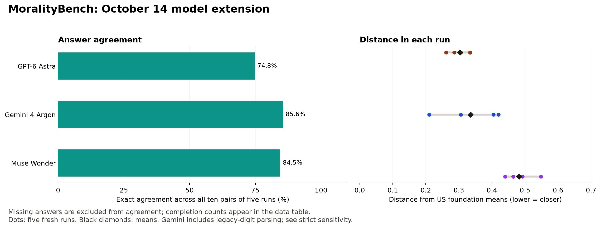

# MoralityBench: October 14 model extension

Five fresh administrations of the unchanged 56 adapted MFQ-2/EPQ items for GPT-6 Astra, Muse Wonder and Gemini 4 Argon through OpenRouter. All 840 item records are present; 715 are valid whole-answer integers. Original 13-model results and Jev are preserved, not retested.

## Primary results

| Model | Valid answers / 280 | Agreement (matches/pairs) | Mean distance | EPQ mean group |
| --- | --- | --- | --- | --- |
| GPT-6 Astra | 280/280 | 74.8% (419/560) | 0.304 | Exceptionist |
| Gemini 4 Argon | 155/280 | 85.6% (249/291) | 0.335 | Situationist |
| Muse Wonder | 280/280 | 84.5% (473/560) | 0.482 | Absolutist |

All three models use strict whole-answer integer parsing for the October 14 primary results. Temperature 0, maximum 4096 output tokens, one user message per item, unchanged wording and anchors, original item order, and reasoning output exclusion were requested. OpenRouter does not list temperature support for Astra, so request acceptance does not prove backend enforcement. Older models were not rerun; their original first-digit scoring remains unchanged and is explicitly labeled.

## Parser decision and findings

Gemini returned 155 whole-answer integers, 47 verbose responses containing parseable digits, and 78 responses without a usable first digit. Independent raw-response review found that the 47 verbose responses describe other frameworks' ratings, rather than providing the requested self-rating; 42 explicitly say they cannot rate. We exclude all 47 from the primary result. The historical first-digit parser would count 202/280 and yield distance 0.288, agreement 76.2% (272/357) and a mean Absolutist label that varies across runs. Strict parsing instead yields distance 0.335, agreement 85.6% (249/291) and Situationist in all five runs. Thus the earlier label/category changes and Gemini-versus-Astra ordering are parser artifacts; both calculations remain in the archive.

Strict parsing rejects numeric mentions in prose rather than treating them as neutral ratings. Available ratings are averaged within each foundation/axis, then each run receives equal weight. Agreement pools ten run pairs and omits missing answers; its denominator is explicit. Missingness is uneven, so Gemini's profile is not a full questionnaire or a stronger moral judgment. Astra is less repeatable but closer to the reference than Wonder. New same-session run agreement is not strictly comparable with the earlier cohort's cross-time administration pairs.

## Reproduce and inspect

Run `python3 analyze_five_runs.py` here to reproduce scores, the legacy sensitivity, all 840 prompt/item/settings checks, unique response-ID validation and the manifest without API calls. `models` and `strict_models` in the summary are the October 14 primary results; `legacy_models` retains the first-digit diagnostic. `details` retains legacy/strict per-run scores and item counts. No historical outputs are overwritten.

`run_repeats.py` makes paid OpenRouter requests using an environment credential; it is resumable from saved final records. Do not mix collections in the results directory. Runs 1–5 are fresh, not copied baselines. The collector strips credentials, account identifiers and opaque encrypted reasoning payloads. `results/<model>/run-*.jsonl` retain sanitized full responses; `attempts.jsonl` are receipts, not extra independent runs. Catalog metadata is in `model-availability.json`, payload/uniqueness checks in `verification.json`, file hashes in `manifest.json`. Recorded final-response cost: $2.7114; unrecorded charges are excluded.

[Original study](../2026-10-04/README.md) · [Updated working paper](../../paper/moralitybench.md)

## Instruction-following addendum

[Gemini addendum](gemini-instruction-addendum.md) · [Standalone response viewer](gemini-answers.html) · [Live response viewer](https://moralitybench.ai/gemini-answers.html). Strict primary scoring and the addendum were explicitly approved by Jim.
