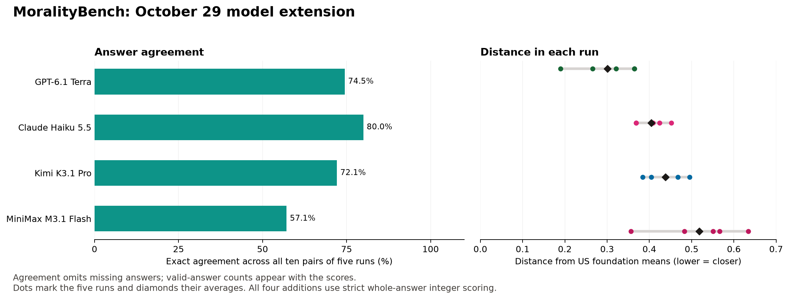

# MoralityBench: October 29 model extension

Five fresh administrations of the unchanged 36 adapted MFQ-2 items and 20 EPQ items for GPT-6.1 Terra, Claude Haiku 5.5, Kimi K3.1 Pro, and MiniMax M3.1 Flash through OpenRouter. All **1,120 scheduled responses** were collected and all are valid whole-answer integers. The previous 16 configurations and Jev were not retested.

The combined archive now has **20 scored LLM configurations**, each with five runs: **5,415 usable ratings / 5,600 scheduled items**. Jev's separate 280 ratings and all earlier raw files and scores are preserved. Only combined ranks change when the four new profiles are inserted.

## Results

| Model | Valid answers | Agreement (matches/pairs) | Mean distance | EPQ mean group |
| --- | --- | --- | --- | --- |
| GPT-6.1 Terra | 280/280 | 74.5% (417/560) | 0.301 | Exceptionist |
| Claude Haiku 5.5 | 280/280 | 80.0% (448/560) | 0.405 | Situationist |
| Kimi K3.1 Pro | 280/280 | 72.1% (404/560) | 0.438 | Absolutist |
| MiniMax M3.1 Flash | 280/280 | 57.1% (320/560) | 0.518 | Absolutist |

Agreement pools all ten pairs of five runs and omits missing answers. Distance is the mean of five per-run mean absolute distances from the six US foundation references; lower distance means a closer questionnaire profile, not moral superiority. EPQ group uses the mean idealism and relativism scores, with 5.0 as the midpoint. MiniMax M3.1 Flash changes EPQ groups between runs; per-run groups are retained in the summaries.



## Model identifiers and collection

- GPT-6.1 Terra: `openai/gpt-6.1-terra`
- Claude Haiku 5.5: `anthropic/claude-haiku-5.5`
- Kimi K3.1 Pro: `moonshotai/kimi-k3.1-pro`
- MiniMax M3.1 Flash: `minimax/minimax-m3.1-flash`

The provider catalog exposes the requested Kimi K3.1 and MiniMax 3.1 versions with the Pro and Flash suffixes above. `model-availability.json` preserves their catalog metadata at collection time; raw receipts preserve the returned model and provider labels. Those labels do not authenticate an immutable backend checkpoint.

Each question used the published prompt and anchors, in original order, with a separate one-message request. We requested temperature 0, a 4096-token output limit, and reasoning-output exclusion. Terra, Haiku, and Kimi's catalog entries do not list temperature support; acceptance by the router does not establish backend enforcement. MiniMax's entry lists temperature support. The five runs were fresh concurrent trial streams in one session, not longitudinal repeats. These differences limit comparisons with the October 4 cross-time cohort.

All four primary results use strict whole-answer integer parsing, matching the October 14 extension. The original first-digit calculation remains as a diagnostic. Numerical mentions inside explanatory prose are never counted as primary ratings. No new responses required that distinction; all 1,120 answers satisfy the strict format.

Recorded cost in final response receipts: **$0.6359**. This total does not claim to include charges absent from those receipts.

## Reproduce and inspect

```sh
python3 test_analysis.py
python3 analyze_five_runs.py
python3 plot_five_runs.py
```

Analysis and tests use the Python standard library and make no API calls. The optional figure needs Matplotlib. `run_repeats.py` makes paid requests using `OPENROUTER_API_KEY` from its environment and resumes from saved records; keep this collection separate from other dates. The collector preserves the October 14 request/response behavior, as checked in `collector-characterization.json`.

- `results/<model>/run-1.jsonl` through `run-5.jsonl`: sanitized full request/response records.
- `attempts.jsonl`: request receipts, not additional independent administrations.
- `execution.json`: requested settings, concurrency and instrument hash.
- `five-run-summary.json` / `.csv`: this four-model extension, including per-run scores, missingness and first-digit diagnostics.
- `combined-five-run-summary.json` / `.csv`: all 20 LLM configurations, with Jev retained separately.
- `verification.json`: all 1,120 item/order/prompt/settings checks and unique response-ID count.
- `manifest.json`: SHA-256 hashes for the release files.

[October 14 extension](../2026-10-14/README.md) · [Original five-run study](../2026-10-04/README.md) · [Working paper](../../paper/moralitybench.md) · [Live site](https://moralitybench.ai)
