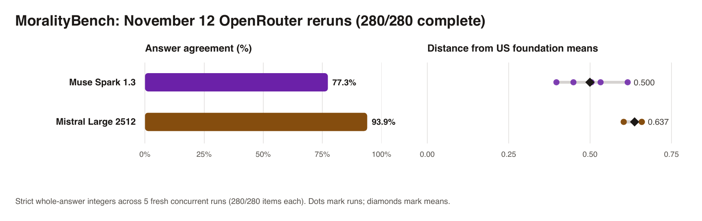

# Repeated-run study extension: 2026-11-12 (OpenRouter reruns)

Five fresh concurrent administrations for **Muse Spark 1.3** (`meta/muse-spark-1.3`) and **Mistral Large 2512** (`mistralai/mistral-large-2512`, pinned via OpenRouter to `mistral/eu` with `allow_fallbacks: false`), completing two configurations that had failed or hit rate limits on October 4:

- **Muse Spark 1.3** had failed all 280 items on October 4 with HTTP 403 (`age attestation` required). With the OpenRouter 18+ account toggle enabled, it answered **280/280** strict whole-number items via Google (`$0.4662` recorded OpenRouter cost).
- **Mistral Large 2512** originally completed **249/280** items on October 4 (19 non-integer prose baseline replies + 12 HTTP 429 rate-limit failures). Running five fresh concurrent trials pinned strictly to `mistral/eu` yielded **280/280** strict whole-number items (`$0.0241` recorded OpenRouter cost). Separately, recovering the 12 missing October 4 HTTP 429 items under `mistral/eu` (`oct4-recovery/`, `$0.0010`) yields virtually the same profile (`261/280`, mean distance `0.638`, `94.6%` agreement across `484` pairs), so the complete 280/280 November 12 rerun supersedes the incomplete October 4 entry in the 21-LLM leaderboard (`superseded_models`).

All scores below use strict whole-answer integers, zero unretried nonconforming outputs, and the frozen October 4 scoring formulas (`mean(|MFQ_model - US_norm|)` per run averaged across runs, midpoint `>= 5` on EPQ).



## Rerun cohort summary

| Model | Provider | Strict numeric | Pairwise agreement | Distance mean (SD) | Distance range | Ideology | Recorded cost |
| --- | --- | ---: | ---: | --- | --- | --- | ---: |
| Muse Spark 1.3 | Meta (`Google` route) | 280 / 280 | 77.3% (`433 / 560`) | 0.500 (`0.083`) | 0.397 – 0.616 | Absolutist (flips 1/5 to Situationist) | $0.4662 |
| Mistral Large 2512 | Mistral AI (`mistral/eu`) | 280 / 280 | 93.9% (`526 / 560`) | 0.637 (`0.030`) | 0.603 – 0.659 | Situationist (stable 5/5) | $0.0241 |

With **280/280** strict answers, **Mistral Large 2512** ties **Llama 4 Maverick** to the exact pair count (**526 / 560 = 93.9%**) for the highest repeatability among LLMs with complete data. **Muse Spark 1.3** ranks 16th of 21 LLMs by mean distance (`0.500`), while **Mistral Large 2512** remains 21st (`0.637`). Combined across all four cohorts (`2026-10-04`, `2026-10-14`, `2026-10-29`, `2026-11-12`), LLM coverage rises from `5,415 / 5,600` (`96.7%`) to **`5,726 / 5,880` (`97.4%`)**, or **`6,006 / 6,160`** including Jev (`95.7%`, `280/280`).

## Verification

```sh
python3 repeated-runs/2026-11-12/analyze_five_runs.py
python3 -m unittest repeated-runs/2026-11-12/test_analysis.py
```

Both scripts run completely offline on the archived JSONL files, verify all `572` distinct response IDs (`560` fresh + `12` October-4 recovery), recompute both strict and first-digit parsers from raw response strings, preserve all 19 untouched LLMs and Jev identically except combined rank, and check SHA-256 digests in `manifest.json`.
